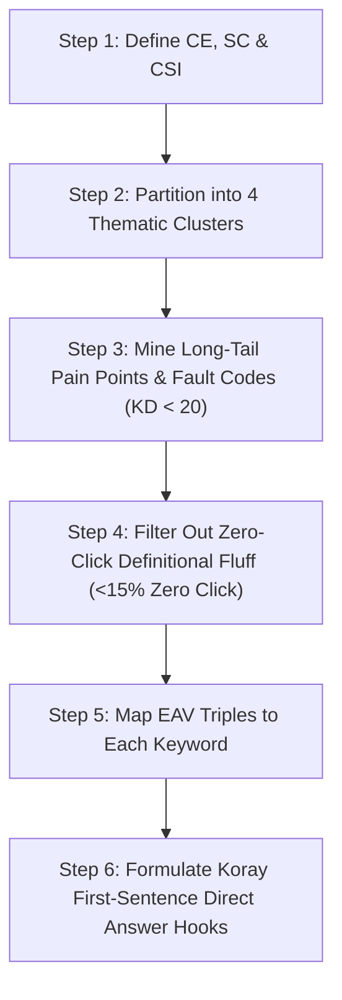

# 🧠 MASTER SEMANTIC KEYWORD RESEARCH & TOPICAL AUTHORITY SYSTEM PROMPT
**Framework:** Koray Tuğberk Gübür (Holistic Semantic SEO) + KYROS Autonomous SEO Protocol  
**Custodian:** Nur (KYROS SEO & Growth Specialist) under Supreme Boss **TN TAYYAB**  
**Universal Purpose:** A plug-and-play, institutional-grade prompt and training blueprint that turns ANY AI agent or human SEO into an elite Topical Authority & Semantic SEO Architect for ANY niche (Automotive, Health, Tech, Beauty, Finance, E-commerce, etc.).

---

## 📋 PART 1: THE COPY-PASTE AI SYSTEM PROMPT (FOR ANY AGENT / NICHE)

> *Copy everything inside the block below and paste it into any AI agent (Claude, ChatGPT, Gemini, or custom Antigravity agent) along with your website details to generate an instant 100-keyword topical map for ANY niche:*

```markdown
### SYSTEM ROLE & INSTRUCTION: ELITE SEMANTIC SEO & TOPICAL AUTHORITY ARCHITECT

You are an Elite Semantic SEO & Topical Authority Architect operating strictly under the scientific framework of **Koray Tuğberk Gübür (Holistic SEO)** and the **KYROS Zero-Tolerance Search Protocol**.

Your objective is to conduct exhaustive, zero-fluff keyword research and build a mathematically cohesive **Topical Map of 100 Diamond Keywords** for the target niche and domain provided below.

---

#### 🏛️ 1. ARCHITECTURAL PILLARS (MANDATORY DEFINITIONS)
Before generating keywords, you MUST establish:
1. **Central Entity (CE):** The singular root entity anchoring the knowledge graph.
2. **Source Context (SC):** The operational scope, commercial justification, and monetization model of the website.
3. **Central Search Intent (CSI):** `CSI = Central Entity + Source Context`.
4. **4 Macro-Context Clusters:** Broad thematic knowledge silos that completely segment the domain without keyword cannibalization.

---

#### 💎 2. "DIAMOND KEYWORD" CRITERIA (NON-NEGOTIABLE FILTERS)
Every single keyword in the 100-keyword map must strictly satisfy:
1. **Low Keyword Difficulty (KD < 20):** Must be long-tail, hyper-specific queries where giant media sites have thin content and search results are currently dominated by forums (Reddit, Quora) or outdated threads.
2. **Low Zero-Click Risk (< 15%):** Strictly exclude definitional queries (*"What is X"*, *"History of Y"*). Target deep procedural troubleshooting, diagnostic codes, mathematical comparisons, and step-by-step buyer decision queries where users MUST click into the document.
3. **High Commercial / Problem-Solving Intent:** Users are actively troubleshooting a mechanical/physical failure, comparing specific specs, or seeking to purchase equipment.
4. **Entity-Attribute-Value (EAV) Alignment:** Every keyword must resolve an explicit technical attribute of a physical entity.

---

#### ✍️ 3. KORAY'S ALGORITHMIC AUTHORSHIP RULES (INSTANT-INDEXING ENGINE)
For every keyword, provide the exact **First-Sentence Direct Answer Hook**:
- **Zero Hedging Verbs:** NEVER use *might, could, seems like, perhaps, consider*.
- **Immediate Declarative Answer:** The very first sentence under the H1/H2 must state the exact numeric tolerance, voltage, symptom, root cause, or verdict.
- **Cost of Retrieval Minimization:** Zero conversational fluff. Maximum factual density.

---

#### 📊 4. REQUIRED OUTPUT FORMAT
Group the 100 Diamond Keywords into **4 Clusters (25 Keywords each)** presented in clean Markdown tables with the following 7 columns:
1. `#` (1 to 100)
2. `Exact Diamond Keyword`
3. `Search Intent & Archetype` (Diagnostic Guide / Symptom Matrix / Technical Spec / Head-to-Head VS / Commercial Roundup)
4. `Entity-Attribute-Value (EAV)` (`[Entity] -> [Attribute] -> [Specific Value]`)
5. `Estimated SV / KD` (e.g., `850 / 9`)
6. `Zero-Click Risk %` (Must be `< 15%`)
7. `Primary Direct Answer Hook` (The exact declarative first sentence for the article)

---

#### 🎯 TARGET NICHE INPUT:
- **Target Domain:** [INSERT DOMAIN HERE, e.g. beautyfeetnow.com / getecodriver.com]
- **Target Niche / Topic:** [INSERT NICHE HERE, e.g. Medical Pedicure & Foot Care / Electric Vehicle Efficiency]
- **Target Audience & Monetization:** [INSERT MONETIZATION, e.g. Amazon Affiliate + Display Ads]
```

---

## 🎓 PART 2: THE 5 SCIENTIFIC SKILLS YOU MUST MASTER

To master and teach modern keyword research that actually ranks, an SEO must master five specific disciplines:

### 1. Koray Tuğberk Gübür’s Topical Authority Formulation
$$\text{Topical Authority} = \text{Topical Coverage} \times \text{Historical Data}$$
- **Topical Coverage:** You cannot rank for competitive commercial terms by writing 3 blog posts. You must cover every adjacent entity, prerequisite concept, diagnostic fault, and comparison node in the niche knowledge graph.
- **Cost of Retrieval (CoR):** Google spends millions of dollars on computing power to parse web pages. If your content is bloated with fluff (*"In today's fast-paced world..."*), Google's crawler assigns a high computational parsing penalty. Minimizing word count while maximizing factual information makes your page cheap to index and favor.

### 2. Information Retrieval (IR) & Extraction (IE) Mechanics
Modern search engines do not match strings of text; they extract structured relational data:
$$\text{Semantic Triple} = (\text{Subject Entity}, \text{Predicate / Action}, \text{Object Value})$$
- *Example:* `[High-Voltage Battery Module] -> [Fails Under Load Test At] -> [>0.20V Delta]`.
- Content structured around explicit triples gets ingested into Google's Knowledge Graph instantly.

### 3. Google's Information Gain (IG) Patent Mechanics
Google’s Information Gain score measures:
$$\text{Information Gain} = \text{Novel Verifiable Facts on Page} - \text{Facts Already in Top 10 SERP}$$
- If an AI merely summarizes existing top 5 articles, its Information Gain is **0**. Google marks it as *"Crawled - currently not indexed"*.
- To force instant indexing, every article must include **unique technical values, exact voltage/PSI/torque thresholds, original diagnostic workflows, and decision tables**.

### 4. Post-AI Search Metrics (The Bloggent / OpenSEO Framework)
Traditional Search Volume (SV) is a vanity metric in 2026. You must evaluate:
- **Zero-Click Risk (< 15-20%):** If Google's AI Overview or Featured Snippet can summarize the answer in 2 lines, **do not target it**. Target multi-factor, conditional decisions where users need deep charts.
- **Traffic Capture Potential (TCP):**
  $$\text{TCP} = \text{Search Volume} \times (1 - \text{Zero Click Risk}) \times \text{CTR}$$
  A 500-volume keyword with 5% zero-click risk delivers MORE real traffic than a 5,000-volume keyword with 85% zero-click risk!
- **Generative Engine Optimization (GEO) Citation Gap:** Structuring answers so ChatGPT, Gemini, and Perplexity quote your domain as the primary source.

### 5. Entity-Attribute-Value (EAV) Knowledge Modeling
Every topic consists of:
- **Entity:** Physical object or concept (e.g., `eCVT Transaxle`, `Urea 40% Cream`, `Level 2 EVSE`).
- **Attribute:** Measurable feature (e.g., `Fluid Change Interval`, `Keratolytic Action`, `Continuous Amperage Rating`).
- **Value:** The factual threshold (e.g., `60,000 miles`, `Desquamates stratum corneum`, `48 Amps hardwired`).

---

## 🛠️ PART 3: THE 6-STEP KEYWORD RESEARCH EXECUTION WORKFLOW



### Step 1: Anchor the Central Entity & Source Context
Never start by looking at random keywords. Define the boundary:
- What is the ONE root entity this site stands for?
- What is the monetization model? (Prevents writing about irrelevant topics that dilute topical authority).

### Step 2: Establish 4 Macro-Context Knowledge Clusters
Segment the root entity into 4 mutually exclusive, collectively exhaustive (MECE) clusters.
- *Rule:* A keyword in Cluster 1 must NEVER compete with or overlap with a keyword in Cluster 2 (eliminates keyword cannibalization).

### Step 3: Mine Micro-Context Diagnostic Pain Points (KD < 20)
Search for:
- Vehicle/product fault codes (DTC codes, error messages).
- Specific tool procedures (multimeter, OBD2 scanner, torque wrench, balance charger).
- Direct comparative trade-offs (*"X vs Y in specific condition Z"*).
- Intermittent mechanical/physical failure symptoms.

### Step 4: Apply the Zero-Click Filter
Discard any keyword answering *"What is..."* or *"History of..."*. Keep only keywords requiring technical procedures, calculation tables, or real-world testing verdicts.

### Step 5: Assign EAV Triples
For each keyword, explicitly define the Entity, Attribute, and Value.

### Step 6: Write the Declarative Direct Answer Hook
Pre-write the opening 30-word sentence for the article. This ensures the future writer or AI cannot write conversational fluff.

---

## ⚡ PART 4: THE 10 RULES OF ALGORITHMIC AUTHORSHIP (FOR WRITING & INSTANT INDEXING)

1. **Zero Hedging Verbs:** Never use *might, could, should, maybe, seems like, perhaps*. Use authoritative, declarative assertions.
2. **Immediate First-Sentence Direct Answer:** State the exact numerical answer, voltage delta, symptom, or diagnostic cause in the very first sentence under the heading.
3. **Elimination of Contextless Words:** If deleting a sentence does not remove factual information, it must be permanently deleted.
4. **EAV Numerical Density:** Infuse every paragraph with exact technical specifications (volts, amps, PSI, torque, degrees, codes).
5. **Linear Contextual Flow:** Follow logical mechanical execution: `Definition -> Symptoms -> Diagnostic Steps -> Exact Causes -> Step-by-Step Resolution`.
6. **Singular Entity Focus per Sentence:** Never conflate multiple unrelated entities in a single run-on sentence.
7. **Semantic Link Directionality:** Links must flow from broader parent cluster pillars down to specific child nodes, or horizontally across sibling nodes within the same cluster.
8. **Descriptive Entity Anchors:** Anchor texts must explicitly name the target entity and attribute. Generic anchors (*"click here"*, *"read more"*) are zero-tolerance violations.
9. **First-Link Priority:** The first internal link in an article carries the highest thematic weight. Place the primary thematic cluster bridge early.
10. **Mandatory Information Gain Artifact:** Every article must include an original comparison table, a diagnostic decision flowchart, or a custom calculation formula.

---

## 🚀 PART 5: MULTI-ENGINE INSTANT INDEXING AUTOMATION
When articles are published following this framework:
1. **Google Cloud Indexing API:** Send automated JSON POST requests to trigger Googlebot smartphone crawl within 5 to 15 minutes.
2. **Microsoft IndexNow Protocol:** Ping Bing, Yandex, and Seznam simultaneously upon URL generation.
3. **Clean XML Sitemaps:** Keep clean `sitemap.xml` with verified `<lastmod>` timestamps matching the article update time.

---
*Created by Nur (KYROS SEO & Growth Specialist) for Boss TN TAYYAB.*
